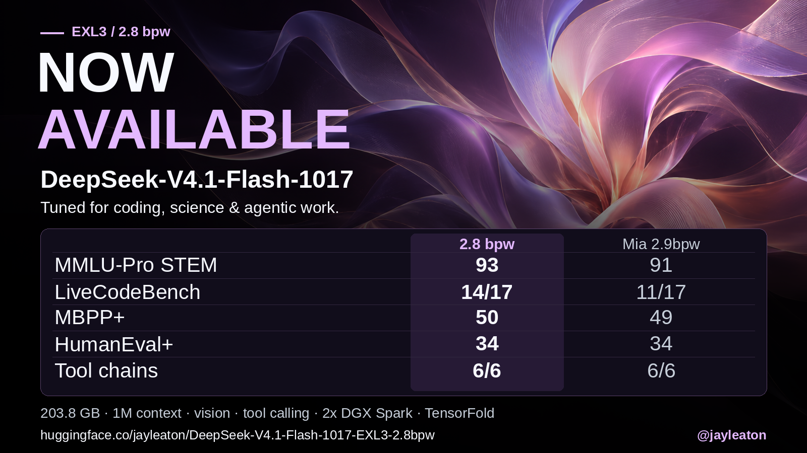

Follow me on X for more updates: https://x.com/jayleaton

Support me here: https://buymeacoffee.com/jayleaton

# DeepSeek-V4.1-Flash-1017 on TensorFold, 2x NVIDIA DGX Spark

> **Do not merge: engine pin not public yet.** This branch pins TensorFold `5d25d4ff4`, which is not yet published
> to [`config/tensorfold.repo`](config/tensorfold.repo); see below.



A recipe for serving DeepSeek-V4.1-Flash-1017 on two NVIDIA DGX Sparks behind an OpenAI-compatible API. It ships
our EXL3 pack (**flash17**) and a pinned upstream TensorFold native build. The measurements below describe
the previously deployed engine and profile.

| | |
| --- | --- |
| Model | [`deepseek-ai/DeepSeek-V4.1-Flash-1017`](https://huggingface.co/deepseek-ai/DeepSeek-V4.1-Flash-1017) |
| Pack | **EXL3 2.8 bpw, 203.8 GB**: [`jayleaton/DeepSeek-V4.1-Flash-1017-EXL3-2.8bpw`](https://huggingface.co/jayleaton/DeepSeek-V4.1-Flash-1017-EXL3-2.8bpw) |
| Hardware | 2x DGX Spark (GB10, 128 GB each), tensor parallel 2 over the 200 Gb/s CX7 link |
| Engine | upstream TensorFold, pinned in [`config/tensorfold.rev`](config/tensorfold.rev) |
| Serving | 1M context, four slots, vision (native image input), tool calling, structured output, built-in Python tool ([compute lane](docs/OPERATIONS.md#compute-lane-tf_dsv41_compute_lane-on-in-the-flash17-profile)) |

This branch migrates the recipe to upstream native serving. The pin is TensorFold `5d25d4ff4`, the G port: the 40
commits of release candidate G (`58bece1d3`) ported onto the line that carries the in-model runner (`5074ee87d`, with
the `TF_DSV41_BIAS_VL` and `TF_DSV41_NO_FORCED_DRAFTS` settings fixes, the forced-rows hold, graph-bank teardown frees
and runner proof fixes), plus a lean fixup (`0e547b124`), a health-test brace fix (`5114cb28d`) and `5d25d4ff4`
itself: the vision wrapper forwards held replies to its engine, without which the compute lane refused at boot with
image input on. Production serving on two Sparks switched to it on 2026-11-11, with the CUDA forward-compatibility
layer ([OPERATIONS](docs/OPERATIONS.md#cuda-forward-compatibility-tf_cuda_compat); CUDA 13.3's 610.43.02 driver over
the host's 580 kernel module, `TF_CUDA_COMPAT=0` for the host driver). It also carries the NVMe session-restore fix of
upstream #2182 ([#86](https://github.com/jayleaton/deepseek-v41-tensorfold-spark/issues/86)) and flash17’s `dsq-1`
admission support. The previous pins are the fallbacks: `7b79ef92d` on `dsv41/compute-lane-release-s86` (the
compute-lane release with #2182, whose branch holds the exact source the [compute-lane studies](docs/compute-lane.md)
ran) and release candidate G, `58bece1d3` (F `56200688d` before it). The flash17 profile's default is the in-thinking
"tool-full" profile, whose runner and trust guide run for every thinking chat whatever the client sends (the built-in
tool only when its reply has room for a call); it needs the runner image (`scripts/build-runner-image.sh`). The measured
lane-only arm is an opt-in block. See [ENGINE](docs/ENGINE.md).

**Before this branch can merge**, `5d25d4ff4` must be published to JJ's TensorFold fork
([`config/tensorfold.repo`](config/tensorfold.repo)); it is not there yet, so the default build cannot fetch it. Until
then, build with `TENSORFOLD_SOURCE` set to a local checkout or bundle that contains it
([ENGINE](docs/ENGINE.md#build-and-checks)). The pin is not on upstream main either.

Against production G on 2026-11-11 (TP2, flash17 K6 pack, compute lane on), the switch boot decoded at a geometric mean
of **1.024×** over four cells, its replies were token-identical to G's on 12 of 12, and the correctness checks passed or
matched G's results ([BENCHMARKS](docs/BENCHMARKS.md#the-g-port-5d25d4ff4)).

On the 2026-10-29/30 spot checks against the previous engine, H passed every correctness gate, with 0 token
differences. It was at parity on 8K prefill (1.06×), 1-stream decode (1.00×) and auto tools (1.02×); 4-stream decode
was 0.97×. The details are in [ENGINE](docs/ENGINE.md#results-at-h-2026-10-2930). Full engine/pack/device
qualification is still pending, and the historical production results below do not qualify this pin.

> **Work in progress.** Measured on one pair of Sparks. Read [what is not solved](docs/KNOWN-ISSUES.md) before
> relying on it.

## Results

**Tasks.** 356 matched items (pass@1, greedy, thinking on, effort high), against Mia-AiLab's 2.9 bpw pack and
our previous q28-v2 pack:

| Suite | flash17 | Mia 2.9 bpw | q28-v2 |
| --- | ---: | ---: | ---: |
| HumanEval+ | 34 / 40 | 34 / 40 | 33 / 40 |
| MBPP+ | 50 / 60 | 49 / 60 | 50 / 60 |
| MMLU-Pro STEM | 93 / 100 | 91 / 100 | 90 / 100 |
| MATH-500 | 36 / 40 | 36 / 40 | 36 / 40 |
| SciCode (first step) | 6 / 10 | 6 / 10 | 5 / 10 |
| LiveCodeBench | 16 / 20 | 13 / 20 | 13 / 20 |
| BFCL | 39 / 40 | 39 / 40 | 39 / 40 |
| Tool chains | 6 / 6 | 6 / 6 | 4 / 6 |
| MGSM | 40 / 40 | 40 / 40 | 40 / 40 |

Small samples: every paired 95 % confidence interval includes zero, so these show no statistically significant
difference. Intervals, method and limits are in [FLASH-1017](docs/FLASH-1017.md#task-results-356-items).

**Retention of the 1017 release, as served** (top-1 agreement with the release, with the serving expert pruning):
code **95.17 %**, science **94.93 %**, tools **87.64 %**. The full table, with KL and the other packs:
[FLASH-1017](docs/FLASH-1017.md#fidelity-to-the-release-retention-as-served).

**Speed** at the recommended profile (2.1M pool, 2100 MHz cap), single stream: short decode **87.9 tok/s**; decode
after a 32K / 131K prompt 64.1 / 64.9 tok/s; prompt tokens over time to first token 2,349 / 2,198 tok/s (TTFT includes
HTTP and admission). q28-v2's earlier measurements, under a different clock and its 3.0M pool, were 85.75, 66.7 / 64.5
and 2,630 / 2,460; not a matched A/B. Details: [FLASH-1017](docs/FLASH-1017.md#speed).

**Images and agents** at the recommended profile: VQA 20 / 20 plus 3 / 3 `image_url` probes; a clean OpenCode
session passed (7 valid tool calls, normal stop).

## Quick start

The full guide is [ZIG-SERVE](docs/ZIG-SERVE.md). Build the image and the per-rank assets as it describes, then:

```bash
git clone https://github.com/jayleaton/deepseek-v41-tensorfold-spark.git
cd deepseek-v41-tensorfold-spark
scripts/build-native.sh -t tensorfold-dsv41:local                                    # the engine at the pin
scripts/build-runner-image.sh tensorfold-dsv41:local -t tensorfold-dsv41:local-runner  # + runner assets (downloaded, sha256-checked)
scripts/build-compat-image.sh tensorfold-dsv41:local-runner tensorfold-dsv41:local-runner-compat  # + CUDA forward compatibility
hf download jayleaton/DeepSeek-V4.1-Flash-1017-EXL3-2.8bpw --local-dir /srv/models/flash17   # both nodes
cp config/prod-zig-flash17.env.example config/prod-zig.env && $EDITOR config/prod-zig.env    # both nodes
scripts/run-zig.sh 1 --check-aot   # after generating assets; compare both rank identities before starting
```

- Fill in the node paths and link settings from
  [`config/prod-zig-flash17.env.example`](config/prod-zig-flash17.env.example) and keep its engine settings. It needs
  the **2.1M-token pool** (`TF_DSV41_POOL_TOKENS=2100000`). With q28-v2's 3.0M pool this pack goes under the 4 GiB
  memory floor during 4K prefills ([why](docs/FLASH-1017.md#memory-the-21m-pool)).
- Pack the **1017 Engram shards** with `scripts/pack_engram.py` ([Engram setup](docs/INSTALL.md#engram-source-setup-68), with
  `deepseek-ai/DeepSeek-V4.1-Flash-1017` as the source); the September shards do not match this pack.
- We suggest a 2100-2200 MHz GPU clock cap (`nvidia-smi -lgc 300,2100`) to help with temperature control.
- Check the answer to `What is 17 * 23?` is 391 before serving traffic.

## Rollback to q28-v2

The previous pack, q28-v2
([`jayleaton/DeepSeek-V4.1-Flash-EXL3-2.8bpw`](https://huggingface.co/jayleaton/DeepSeek-V4.1-Flash-EXL3-2.8bpw)),
keeps its own unchanged profile, [`config/prod-zig.env.example`](config/prod-zig.env.example) (September Engram shards,
3.0M pool). Stop rank 0, then start both ranks with that config:
[FLASH-1017, rollback](docs/FLASH-1017.md#rollback-to-q28-v2). Its measurements are in
[PREVIOUS-RESULTS](docs/PREVIOUS-RESULTS.md).

## Documentation

| | |
| --- | --- |
| [FLASH-1017](docs/FLASH-1017.md) | the flash17 pack: profile, memory, task results, retention, rollback |
| [ZIG-SERVE](docs/ZIG-SERVE.md) / [ZIG-RESULTS](docs/ZIG-RESULTS.md) | Zig build, TP=2 launch, exact settings, q28-v2 comparisons |
| [PREVIOUS-RESULTS](docs/PREVIOUS-RESULTS.md) | q28-v2 kit results and the historical 2.9 bpw Python vs vLLM tables |
| [INSTALL](docs/INSTALL.md) | native requirements, weights and Engram shards |
| [API](docs/API.md) / [IMAGES](docs/IMAGES.md) | endpoints, thinking and effort, image input |
| [OPERATIONS](docs/OPERATIONS.md) | settings, memory gates, the optional thermal and memory guard, turning each lever off |
| [SECURITY](docs/SECURITY.md) | where keys live, which processes hold them, what the output filter promises |
| [METHOD](docs/METHOD.md) / [RESULTS](docs/RESULTS.md) / [BENCHMARKS](docs/BENCHMARKS.md) | how it was measured, every table, how to rerun |
| [CHANGELOG](docs/CHANGELOG.md) | bug fixes and new levers since G13 |
| [KNOWN-ISSUES](docs/KNOWN-ISSUES.md) | what is not solved |
| [PROJECT](docs/PROJECT.md) / [ENGINE](docs/ENGINE.md) / [ARCHITECTURE](docs/ARCHITECTURE.md) / [DECODE](docs/DECODE.md) | patches, layout, model split, decode roofline |
| [campaign/](docs/campaign/README.md) | the development log, windows G1-G19 |

## Credits

Built on [TensorFold](https://github.com/ashhart/TensorFold) by Ash Hart (ashhart), and on
[DeepSeek](https://huggingface.co/deepseek-ai/DeepSeek-V4.1-Flash-1017)'s model, papers and code. Measured against
Mia / MiaAI-Lab's [2x DGX Spark kit](https://github.com/MiaAI-Lab/DeepSeek-v4.1-Flash-EXL3-2x-DGX-Sparks) and
[2.9 bpw pack](https://huggingface.co/Mia-AiLab/DeepSeek-V4.1-Flash-EXL3-2.9bpw). EXL3 is by
[turboderp / ExLlamaV3](https://github.com/turboderp-org/exllamav3). Every contributor, project and benchmark we used
is credited in [CREDITS](docs/CREDITS.md).

## Licensing

This project's code, patches, scripts, benchmarks and docs: **Apache License 2.0** ([`LICENSE`](LICENSE),
[`NOTICE`](NOTICE)). TensorFold, the added files, the adapted kernels, the base image and the model weights each keep
their own terms: [`docs/LICENSING.md`](docs/LICENSING.md).

HTTP tooling: [bench/speed.py](bench/speed.py) and [scripts/preflight.py](scripts/preflight.py); see [BENCHMARKS](docs/BENCHMARKS.md).
